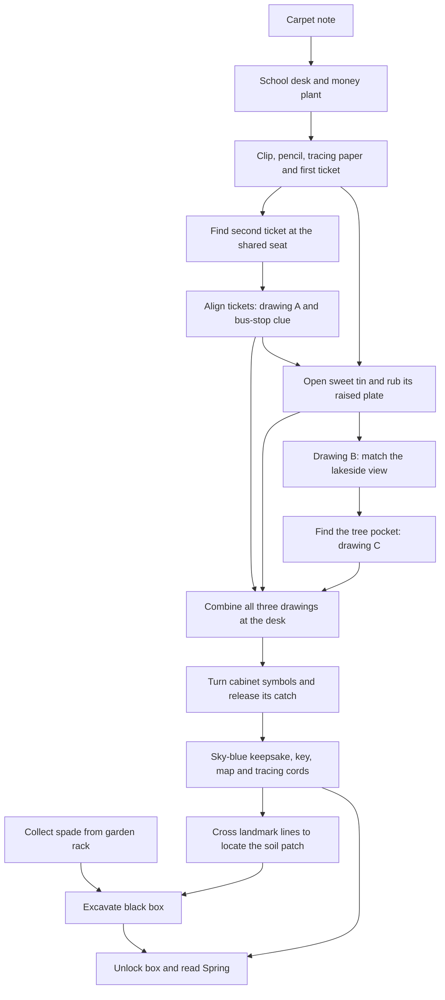

# Spring — The Little Things I Kept

Design and implementation record · original proposal 20 October 2026

Status: implemented locally, with final browser playthrough and production publication in progress on 21 October 2026. The user has requested gameplay review, corrections, finalisation and publication. The current implementation includes the treasure trail, shared clue symbols and a separate classroom reached through the garden door. The sections below retain the original design rationale and proposed authoring details; they do not establish that final visual review or deployment has completed. See [SPRING-REFINEMENT-NOTES.md](SPRING-REFINEMENT-NOTES.md) for the current verification record.

## 1. What Spring should say

The central message is: **I notice you. I keep the little things you trust me with. You mean more to me than I can fit into a message.**

Spring expresses Shyamu's love for Aami. The lake memory also gives it a gentle undertone of the comfort he finds with her. Summer's future warmth and Winter's goodbyes/promises remain separate subjects. The interrupted year and family objections do not become obstacles or villains in this chapter.

Working title: **The Little Things I Kept**. This connects the school gifts, the remembered journeys, the hidden keepsake cabinet, and the book she ultimately finds.

The grove is a treasure trail Shyamu has deliberately prepared for her. Its paper mechanisms and little caches are things he made for this gift. They are not presented as objects that really existed during the couple's memories.

All dialogue below is newly drafted for this experience. It is not a quotation of their historical chats or her original yellow letter.

### Confirmed memories

- An evening classroom; sunlight on her transparent square spectacles; a blue gown. It was not love at first sight, but he remembers the moment.
- Schoolmates in different divisions; he found reasons and ways to see her. Best friends through chats, then a mutual confession by mobile phone.
- A riverside/lake visit: his head in her lap, her face and glasses in sunlight, her gently patting his head.
- A train journey sharing one seat, listening to *Pachai Nirame*, when she asked him to kiss her and their first kiss happened.
- A bus journey, feeding her an orange laddoo; her hair blowing across his face.
- Gifts she entrusted to him: a money plant, hair clip, candle, yellow love note, and a plain sky-blue round hair accessory wrapped with golden thread.
- A long-distance relationship, finding opportunities to meet, and finding their way back to each other.

## 2. Visual direction and scope

Keep the existing cherry grove, picnic arrangement, realistic materials, calm walking, and book presentation. Add carefully staged memory corners within that same grove.

The mood is the first soft sunlight after rain: cool clouds still overhead, warm light catching leaves and the edges of objects, damp darker earth, fresh green grass, occasional droplets, birds returning. It stays comfortable and readable under the canopy.

- Darken Spring's grass and ground greens moderately while retaining texture variation and the existing light.
- Make foliage look fresher and brighter. Preserve the pink blossom identity of the cherry trees; do not recolour whole blossom crowns green.
- Use controlled wet roughness on ground and selected props, shallow puddles in a few depressions, and occasional leaf drips. Avoid making every surface glossy.
- Keep readable shadow detail. The school corner's shadow should feel like shelter, with daylight visibly reaching it.
- Use the current sun/sky system for a break in cloud. Avoid persistent rain, rapid weather transitions, large fog volumes, or expensive new reflection passes.
- Keep the train and bus memories as small recognisable installations: a seat, window frame, travel objects, and a roof/awning. A complete vehicle or recreated school building is outside the base plan.
- Use the blue of her gown/accessory and the golden thread sparingly as recurring accents. They are emotional connections, not universal instructions to click every blue object.

The atmosphere and prop compatibility will be reviewed inside the actual scene before the rest of the art is finished. Free availability alone does not establish a visual match.

## 3. Free asset feasibility

Checked on 20 October 2026. Separate what already exists, what has a verified public source, and what must be made specifically for this puzzle.

### Reuse the current site assets

The current checkout already contains cherry trees, grass, woodland boulders, small rocks, logs, benches, wicker baskets, plates, a thermos, lanterns, the book, and a procedural chest/key. It already has PBR wood, cloth and paper materials, movement, picking up objects, key insertion, a hinged chest and the manga reader.

Reuse those where appropriate. Retain their existing credits, including attribution for CC BY assets. The final black box can adapt the current hinged chest, with a blackened exterior, brass fittings, a waterproof inner wrap and dirt on its outside.

### Verified new source candidates

| Item | Primary source | Verification | Planned treatment |
| --- | --- | --- | --- |
| School desk | [Poly Haven — School Desk 01](https://polyhaven.com/a/SchoolDesk_01) | Public asset page and 1K glTF download metadata checked; source preview visually inspected | A real wood/metal desk, matching the classroom memory. Use its existing open storage shelf rather than inventing a hinged lid in a static scan. |
| Shovel/spade | [Poly Haven — Rusted Spade 01](https://polyhaven.com/a/rusted_spade_01) | Public asset page, formats and preview checked; source preview visually inspected | Wood and metal suit the grove. Reduce the harshness of the rusty colouring if needed; it should look like a garden tool being cared for. |
| Money plant candidate | [Innerscene — Potted trailing pothos](https://www.innerscene.com/tools/library/3d-parts/potted-trailing-pothos-bfe0ed29) | Creator's CC0 page checked; actual GLB downloaded for assessment: 242,668 bytes, 6,684 triangles, four embedded texture images | A practical textured starting point. Confirm appearance in the grove before accepting. It must read as the gifted vining money plant, rather than substituting an unrelated houseplant. |
| Clay pot alternative | [Poly Haven — Planter Pot Clay](https://polyhaven.com/a/planter_pot_clay) | Asset page and 1K glTF metadata checked | Optional pot replacement if the pothos candidate's pot clashes with the setting. |
| Garden worktable | [Poly Haven — Wooden Table 02](https://polyhaven.com/a/wooden_table_02) | Catalog and 1K glTF metadata checked | Optional source for the small tool corner. Reuse existing wood materials if a lightweight custom shelf is sufficient. |
| Candle holder | [Poly Haven — Brass Candleholders](https://polyhaven.com/a/brass_candleholders) | Asset page and 1K glTF metadata checked | Select one holder only if its ornament suits the current scene; otherwise make a simple wax candle and holder. The gift does not require an ornate substitute. |
| Travel case | [Poly Haven — Vintage Suitcase](https://polyhaven.com/a/vintage_suitcase) | Catalog and 1K glTF metadata checked | Optional background travel object. Avoid needing its lid to open: the ticket can be in a separate purpose-made document pocket. |
| Watering can | [Poly Haven — Watering Can Metal 01](https://polyhaven.com/a/watering_can_metal_01) | Catalog and 1K glTF metadata checked | Optional garden dressing; it is not a compulsory extra puzzle. |

Poly Haven states that its assets are [CC0](https://polyhaven.com/license). The Innerscene pothos page explicitly identifies its model as original CC0 work. Save exact source metadata and credit information with imported assets during implementation.

The source previews make the school desk and spade plausible matches for the current wood/metal/scanned landscape. Their final colour, scale and lighting fit still require an in-scene check. No new source model is claimed to be fully integrated or visually approved yet.

### Bespoke models that are practical to make without buying assets

These are small hard-surface, cloth, paper or botanical details. They do not depend on finding a matching free model with working moving parts.

- Transparent square spectacles with thin frames, placed beside a folded piece of blue fabric. These recall the opening; no human character model is needed.
- A brandless phone with a simple readable screen. It contains a short reconstruction of the story, not real chat screenshots.
- The hair clip and sky-blue round hair accessory with golden thread. The accessory's exact silhouette remains adjustable from a reference.
- Pencil, translucent sheets, folded envelopes, ticket sleeves and the yellow note.
- Orange laddoos: small uneven orange sweet surfaces, with restrained granular detail, not smooth orange balls.
- A hinged sweet tin with a removable inner tray and a raised drawing plate under it.
- A little keepsake cabinet with three physical symbol wheels and an actual sliding catch.
- A flat light frame, sheltered candle, map board, pin sockets and gold-coloured tracing cords.
- A small weatherproof letter pocket and garden tool rack.
- Reusable timber window/awning frames and a short plank footbridge, using the site's material family.

Realism comes from appropriate proportions, rounded edges, PBR surfaces, restrained wear, grounded placement and matching light. The small pieces must be inspected close up before being accepted. If a personal prop looks crude, refine that prop rather than hide it behind bloom or replace it with an unrelated stock object.

No paid assets are a prerequisite. Large animated people, full train/bus interiors, cloth simulation, scent simulation and live optical reconstruction are outside the base plan.

## 4. Walking layout

The current woodland walking radius is about 26.9 m. Propose a Spring-specific radius of about 36 m, approximately 72 m across, with irregular planting at the perimeter. This increases the nominal walkable area by about 79% before accounting for water and obstacles. The other seasons keep their current boundaries.

Use one winding main loop and a clear shortcut back to the school desk. Keep main paths approximately 1.8–2.2 m wide and provide generous turning spaces around interaction areas. Expansion should create distinct destinations, not long stretches of empty walking.

Coordinates below are proposed authoring anchors in the current scene's X/Z metre system. They are not surveyed final placements. Reserve clearings before regenerating trees and collision/navigation data.

| Area | Approximate X/Z | Contents and reason |
| --- | --- | --- |
| Entry and picnic | Existing picnic near (-3.7, -2.2) | Preserve its composition. The first note rests on the carpet/blanket beneath a small paperweight. |
| School memory corner | (-11, 2) | One desk under a light timber awning; clear spectacles, blue fabric, money plant, phone, instrument pouch, candle/light frame and wooden keepsake cabinet. Visible enough from the picnic to recognise the opening clue. |
| Shared-seat corner | (-19, -11) | A short cushioned seat bay, a timber/metal window frame and a travel pocket. It suggests the train journey without requiring a whole carriage. |
| Bus-journey stop | (-12, -24) | A sheltered bench, open side to catch the breeze, sweet tin and a small writing surface. |
| Lakeside resting place | (15, -17) | Bench beside a modest reflective pool/inlet, a distinctive cherry tree and a shallow-bank footpath. This evokes the memory without claiming to recreate its real geography. |
| Garden tools | (5, -28) | A small open rack/worktable with the spade and modest garden dressing. It is reachable from the main path. |
| Final grove | Around (22, -24) | Damp disturbed soil, with nearby recognisable map landmarks. The black box is physically below this patch from the start. |

The pond stays modest. Reuse the existing lake/water knowledge in a Spring-specific component, with a cheap environment reflection on constrained devices. It does not need swimming, deep wading or a large river simulation. A small footbridge crosses only a narrow inlet; the required route remains easy to navigate.

Suggested path: picnic → school → shared seat → bus stop → lakeside → central shortcut to school → garden rack → final grove. Places can be visited earlier; clue readability and physical access establish the intended progression.

## 5. Puzzle and story sequence

First-time target: approximately 30–40 minutes including exploration and reading. This is a playtest target, not a promise or a minimum enforced through waiting. A player who understands the mechanisms may finish faster.

### Arrival — A note on the carpet

**Purpose:** invitation, orientation and one obvious first interaction. Approximately 2 minutes.

The cream note is partly tucked beneath a small stone so it belongs naturally in a recently wet grove. A lifted corner and readable proximity prompt establish that paper can be inspected. Opening it does not lock the player into a long cutscene.

**Draft text:**

> Aami,
>
> I didn't fall in love with you in a single moment.
> But I still remember that evening: the light on your square glasses, and the blue you wore.
>
> Somewhere between finding reasons to see you and waiting for your messages, you became my favourite person.
>
> I have left a few little things for you here.
> Begin where that evening has left its light.
>
> — Shyamu

**Solve:** recognise the nearby desk/window setting, transparent square spectacles and blue cloth. All of those visual cues exist in the scene; she does not need to remember a precise date or classroom number.

**Output:** leads her to the school corner.

### 1 — What kept growing

**Purpose:** personal searching, learning inspection, acquiring useful objects. Approximately 4–5 minutes.

At the desk, the wooden keepsake cabinet is visibly locked. Its front has three symbol wheels, a small catch, and this inscription:

> I made a place for the things you trusted me to keep.
> Bring the three drawings back together, and the little pictures will show you how it opens.

This introduces the return destination without making the lock the first obstacle.

A short card near the plant says:

> Some of the things you gave me stayed exactly as they were.
> One of them kept growing.

**Solve:** inspect the money plant and lift its saucer. A visible envelope edge guides the search. The roots and plant remain intact. No compulsory watering action is added merely to lengthen the game.

The envelope contains the first ticket sleeve and a note indicating the desk's open shelf. A small pouch there contains a pencil, translucent tracing paper and her hair clip. These can be stored safely in the satchel.

The phone beside it has a short, explicitly reconstructed memory sequence:

> Before we were anything else, you were my best friend.
>
> One day, a phone carried what I was too nervous to say.
>
> And you told me you felt it too.

Its current treasure-trail message says:

> Keep the little ticket. Its other half is waiting where we made room for two in one seat.

**Output:** hair clip, pencil, tracing paper, first ticket sleeve, and the clue to the shared-seat corner. The phone has a paper equivalent in the envelope; sound and tiny chat text are not requirements.

**Why this is fair:** personal recognition gives the search emotional meaning; visible objects and a small envelope edge provide enough evidence in the game itself.

### 2 — One seat, two people

**Purpose:** a substantial visual assembly puzzle. Approximately 4–5 minutes.

The shared-seat corner has a window bay and a single cushioned seating space. A small label shows the song title *Pachai Nirame*. The second ticket sleeve is in a reachable seatback document pocket, discoverable by inspection. There is no need for a full scanned train interior or a moving vehicle.

**Draft note:**

> We made one seat enough for two.
> Let these two pieces share their place too.

**Mechanism:** both sleeves contain partial linework and clear/cut-out windows. Separate, they show incomplete seat outlines and several broken marks. In a close-up, she slides one sleeve over the other and turns it in broad increments. Completing the single seat outline and matching two asymmetric registration notches produces one unambiguous arrangement.

The aligned windows reveal a little drawing of the bus-stop roof and an orange sweet tin. Other line fragments remain incomplete; they will matter when all three drawings are back at the school desk.

The aligned sleeves slide into one protective folder, becoming **memory drawing A**. No precious hair clip is consumed holding them together; the folded tabs of the sleeve hold the alignment.

**Emotional text after discovery:**

> I remember the song. Sharing that seat. You asking me for a kiss.
> The world was moving, and for a little while all I could think about was you.

**Output:** drawing A and a visual clue to the orange tin at the bus stop.

**Physical logic:** printed layers actually align and reveal an image. Nothing elsewhere unlocks because paper happened to be placed on a seat.

### 3 — The wind and the orange sweet

**Purpose:** searching and applying two tools together. Approximately 4–5 minutes.

At the bus stop is a modest sweet tin with orange laddoos in a removable shallow tray. The tin is unlocked. Opening it and lifting the tray reveals a raised drawing plate attached to its inside base. The plate was made for this treasure hunt.

**Draft note:**

> An orange laddoo, a crowded little seat, and your hair finding its way into my face.
> I remember such small things about being close to you.
>
> I left a little print beneath the sweets. Take a copy for the next part.

**Solve:** select the tracing paper and place it over the raised plate. The breeze gently lifts its free edge. Use the hair clip on the tin's thin rim to hold the paper steady, then rub it with the pencil.

The clip has an understandable local job: holding paper against a raised surface while the pencil is used. It is not used as a magic key, bent into a lockpick, or sacrificed.

**Interaction:** one short rubbing stroke or accessible tap action progressively reveals the print; success does not require covering every pixel. She can reattempt indefinitely without running out of paper. In reduced motion, a lifted edge and visual instruction replace repeated flapping.

The print shows a low view beside water: a particular forked cherry tree, footbridge and pair of stones. A marked tree-root pocket is included in the drawing. It also carries the second set of partial symbol lines.

**Output:** **memory drawing B**, with the lakeside sketch. The clip and pencil return to the satchel.

**Physical logic:** rubbing transfers the raised pattern to paper. The result is information, not a distant mechanical event.

### 4 — Where everything became quiet

**Purpose:** observing the actual 3D landscape and using a different viewpoint. Approximately 5–6 minutes.

The sketch's water and landmark shapes lead to the small lakeside clearing. A little blue ribbon on the bench arm indicates that sitting is possible; it does not mark the final cache.

**Draft note at the bench:**

> I still remember resting my head in your lap.
> The sunlight on your face. Your glasses. Your hand on my head.
> I felt so peaceful with you.
>
> Sit for a moment. Look at the drawing from here.

**Solve:** sit and compare drawing B with the view. The lower viewpoint makes its three landmarks line up. Its marked forked tree is now identifiable, including which side has the little weatherproof letter pocket.

She gets up, follows the short bank path and opens the pocket to find **memory drawing C**. This pocket has been there throughout; perspective helps find it rather than conjuring it into existence.

**Interaction:** the sketch can be shown as a faint optional overlay or side-by-side reference. Matching tolerances are generous. Recognition, not exact camera alignment, is the puzzle. She may discover the pocket early through careful exploration, which is a valid solution.

**Draft text inside:**

> You gave me more than things to keep.
> You gave me moments I could return to, even when you were far away.
>
> Bring this drawing home to the little desk. The three belong together.

**Output:** drawing C and the return clue. A central shortcut avoids repeating the entire outward route.

### 5 — The things I kept

**Purpose:** bring earlier discoveries together, open a plausible local mechanism, and reveal the key. Approximately 5 minutes.

At the school desk, a sheltered candle sits beside a small light frame. A diffused backing makes the translucent sheets easy to read. The candle recalls her gift and adds warmth; it is not an invisible UV source and does not burn a message into a letter.

**Solve:** place drawings A, B and C into the frame and align their printed corner marks. Each carries only parts of three symbols. Together, they form **sun → leaf → ripple**, in three clearly separated left-to-right spaces.

Turn the three cabinet wheels to those same symbols in the same order and release the catch. This is the chapter's one explicit combination puzzle. Seven visually distinct symbols per wheel keep it legible; no spelling, numbers, dates, lyrics or exact recollection of chats are needed.

**Mechanism:** the three wheels operate the catch of this cabinet. The catch visibly withdraws; the door opens. The alignment, code and result are co-located. There is no remote carpet lift or unexplained pressure system.

**Output:** her wrapped sky-blue hair accessory, a protected yellow note, and a small parcel containing the brass black-box key, the map board and two short gold-coloured tracing cords.

The original golden thread remains wrapped around the accessory. Separate tracing cords are supplied for the map, so her keepsake is not dismantled to solve a puzzle. The new cords are a visual echo of the golden wrapping, not claimed to be the actual original thread.

**Draft reveal text:**

> The money plant. Your clip. The candle. Your little yellow letter.
> And this little circle of blue, wrapped in gold.
>
> I remember holding it close because it reminded me of the scent of your hair.
> You trusted me with such little things. They never felt little to me.

Represent the original yellow love note as a preserved keepsake, without inventing her handwriting or its wording. A separate new message from Shyamu can be read here. If the original wording is supplied later, a facsimile can replace the closed keepsake envelope.

### 6 — Two lines to somewhere we haven't opened yet

**Purpose:** a genuine final navigation deduction. Approximately 4–5 minutes including retrieving the spade.

The map is a readable hand-drawn version of the actual Spring grove. It shows major destinations and four distinct landmarks, but no ready-made X and no GPS-style destination marker.

Two small drawings on its border show paired landmarks:

- Forked cherry tree → low stone marker.
- Footbridge → paired boulders.

**Draft map text:**

> One line from the tree that parts in two, through the low stone.
> One from the little bridge, through the stones that stand together.
> Where the two lines meet, I have left something for you.
>
> The garden rack has what you need to bring it into the light.

**Solve:** recognise the four landmarks on the map, attach each tracing cord between the appropriate pair of map pins and extend it along the same straight line. The two lines cross at the buried-box location.

Use tap-to-select pin pairs or a generous snapping drag. No compass arithmetic, counting footsteps or perfect physical thread manipulation is needed. The map can be oriented to the view; it should not require knowledge of world coordinates.

**Proposed geometric layout:** forked tree (15, -24), low stone marker (28, -24), footbridge (22, -12), paired boulders (22, -30). The two lines cross at (22, -24). Keep the last boulders and stone marker visible from inside the route; adjust the whole group coherently during layout review. These coordinates must be checked against final water and obstacle placement, rather than treated as final terrain measurements.

The spade stands in the garden rack throughout the experience. If she finds and takes it earlier, that is allowed. It does not appear because a note was read.

**Output:** the mapped dig location and an equipped spade.

### 7 — Bring it into the light

**Purpose:** physical payoff and a quiet transition into the book. Approximately 2–3 minutes.

The map intersection corresponds to a small patch of recently disturbed dark soil, with a subtle recognisable stone/leaf arrangement drawn on the map. It is not an enormous glowing X and not a single invisible pixel.

Use the spade at this patch. Three short actions move through visible states: loosen the upper soil, expose the lid, lift the box. Total excavation animation should take roughly 8–12 seconds rather than many repeated taps.

The black box is about book size and was buried shallowly in this prepared patch. The outside carries damp soil; inside, the book is wrapped and dry. A nearby flat stone/dry stand receives the box so opening and reading remain comfortable.

Insert the brass key, turn it, and lift the lid. Reuse and adapt the site's existing key/chest/book animation. Her collected objects remain in the satchel; the key is visibly accounted for at the lock.

**Draft note inside the box:**

> Aami,
>
> I remember the blue you wore before I knew what you would mean to me.
> I remember making room beside you, and how peaceful the world felt when I was close to you.
>
> There are miles between us on so many days. They haven't made these little things less precious to me.
>
> You are my best friend, the person I want to tell things to, and the person I keep finding my way towards.
>
> I made this because I wanted you to walk through a little of the love I carry for you.
>
> This part is ours. Take your time.
>
> — Shyamu

The book is Part One / Spring in the existing reader. Reading is the reward: no more gate or question follows the letter. Once found, she can reopen it on later visits without replaying the hunt. Replaying the trail remains a separate optional action.

## 6. Dependency and early-discovery rules

- Puzzle-critical objects exist from the beginning in their physical homes or inside real closed containers.
- A cache found early remains found. Reading an earlier note is not an invisible prerequisite for opening it.
- Drawing A needs its two sleeves; the rubbing needs paper/pencil and a way to secure it; the cabinet needs its actual wheel setting; the box needs excavation and its key.
- The matching cabinet combination is not rejected just because the player has not clicked every clue. Guessing or inferring it is allowed; later reveals still make sense.
- If she finds and excavates the soil patch before solving the map, preserve that discovery. The black box remains locked until she obtains its key. Do not bury it again or pretend it does not exist.
- The satchel prevents essential objects being dropped into water or lost under scenery. Decorative picnic props can retain the existing carry/drop behaviour.

## 7. Hints and feedback

Use an optional small paper tab labelled **A little nudge**. Hints are specific to the current object and require a tap; there is no repeated unsolicited popup. Offer a gentle observation, a clearer action, and an explicit solution. No score loss, timer, scolding or teasing about her memory.

| Stage | Gentle observation | Clearer action | Explicit solution |
| --- | --- | --- | --- |
| Opening | The first note describes things you can see here. | Look for a desk with clear square glasses and blue fabric. | Walk to the school corner. |
| Plant | Which gift could keep growing? | Look around the plant's saucer. | Lift the saucer, read the envelope, and take the pouch from the desk shelf. |
| Tickets | Neither piece shows the whole seat. | Put one over the other and match the outline and notches. | Show the correct arrangement and let her apply it. |
| Rubbing | The drawing is raised, and there is paper in your pouch. | Clip the paper to the tin, then use the pencil. | Offer to set the paper and clip in place; she can make the rubbing. |
| Lake | This view is drawn from somewhere lower. | Sit at the bench and compare the forked tree, bridge and stones. | Mark the tree pocket in the local sketch, without teleporting the player. |
| Cabinet | Each drawing has unfinished lines. | Stack them in the light frame using their corner marks. | Sun, leaf, ripple, left to right; turn the wheels and release the catch. |
| Map | The map gives two pairs of landmarks. | Stretch a cord through each pair. | Show both correct lines and the crossing area. |
| Dig | The map shows disturbed earth. | Equip the spade at the matching dark patch. | Point to the patch and offer the dig interaction. |

Feedback is local and readable: paper edges meet, the rubbing appears, the view resembles the sketch, a catch moves, a lid releases, soil changes shape. Pair small sounds with these visuals; mute must not prevent progress.

## 8. Phone and desktop interaction

- Keep the current walk/look controls. Opening an object close-up pauses walking and releases camera drag so puzzle gestures cannot move the player.
- On phones, provide large non-overlapping targets around 44–48 CSS px for controls. Enlarge small props in inspection rather than making tiny world-space text compulsory.
- Every drag puzzle has a tap alternative: select a sheet then move/turn it in broad increments; select a tool then its target; select two map pins to place a cord.
- Snap paper to meaningful alignments. There is no sub-pixel placement, forced multitouch, shaking, timed tapping, balance minigame or dexterity test.
- Desktop supports the same actions through pointer and keyboard. Keep existing movement and object bindings where practical; give puzzle controls proper focus and accessible names.
- Inventory is a compact satchel, opened on demand, with collected papers/tools and a journal. It is new work; the current single held-object system is not already a full inventory.
- The journal stores discovered notes and sketches only. It does not reveal future locations or present a permanent task list that tells her every solution.
- Note text is readable English. A later language pass can adapt it to Manglish after the English script is approved.
- Audio starts only after interaction where necessary. *Pachai Nirame* appears as the meaningful song title; solving never requires identifying audio or knowing lyrics. Use the existing suitable soundtrack/ambient audio in the base build; inserting a specific song recording is a separate content choice.
- Reduced motion replaces head/camera bob, prolonged paper flapping and long transitions with short equivalents. Audio, colour and tiny details are never the only clues.
- Save completed actions and collected items locally. Refreshing during a transition resumes in a stable state with no lost clue or locked-out book. Saves are per browser/device in the base scope.

## 9. How to keep this build realistic and doable

### Art and rendering

- Import only assets accepted in an in-scene comparison. Do not download a large scene pack just to obtain a small prop.
- For the school desk, spade and other free sources, create compact runtime GLBs with appropriately reduced geometry and 512/1K textures. Keep original sources outside public files.
- Aim for approximately 5–10 MB of additional compressed Spring art, then measure. This is a budget, not a current measurement. Prefer reuse or simplify optional dressing if over budget.
- Keep the new personal props and puzzle textures small; share wood, metal, cloth and paper materials. Load close-up detail only when needed.
- Add no full people, elaborate character animation or animated vehicles. The memories are conveyed through objects, handwritten text, sound and composition.
- Use a single modest water area and bounded puddle treatment. Do not make a second expensive landscape reflection renderer mandatory on phones.
- Keep all bespoke moving parts separate during modelling: tin lid/tray, cabinet door/wheels/catch, black-box lid/key. Static scans cannot be assumed to have usable hinges.

### Puzzle implementation

- Ticket alignment and the three-sheet combination use authored 2D line art inside object close-ups. Positions/orientations are finite and snap cleanly. Do not require real optical ray tracing or arbitrary image recognition.
- Rubbing uses a reveal mask on an authored texture, driven by a generous stroke/tap. There is no pressure-sensor dependency or paper simulation.
- Lake sketch comes from a known game-camera composition and visible world landmarks. Matching is legible by eye; there is no computer-vision classifier.
- Map lines use known landmark coordinates shared with the world layout. Their intersection and the buried patch must come from the same data.
- Digging is three authored terrain/soil/box states with a short spade animation and small particle effect. Do not implement arbitrary terrain excavation everywhere.
- Cabinet wheels move the local latch; the key opens the actual box. World state follows these physical actions instead of remote, unrelated triggers.

### Existing code to extend after approval

- `app/shrine-void/season-layout.ts`: Spring-specific routes, clearings, radius and navigation; reserve quest props before tree placement.
- `app/shrine-void/scene-pickup.ts`: respect per-season bounds and coordinate held decorative objects with quest inspection.
- `app/shrine-void/season-terrain.ts`, `season-world.ts`, `season-meadow.ts`: selective colour/wetness adjustment, loading and Spring set dressing.
- Add Spring-specific quest data/state, interactable props, close-up puzzles, satchel/journal UI and small water configuration. These are proposed modules, not files already implemented.
- `season-relics.ts`, `season-relic-state.ts`, `season-relic-placement.ts`: adapt Spring's chest/key availability, excavation state and finish while preserving other seasons' existing flow.
- `void-scene.tsx` and scene styles: inventory/inspection focus, touch actions, hints and readable notes.
- Reuse the current manga reader, page progress and book artwork. Preserve existing readers' access when migrating old Spring completion saves; provide an optional fresh trail entry rather than silently erasing their reading progress.

## 10. Implementation order after approval

1. **Visual sample and asset acceptance.** Put the verified desk and spade, money plant candidate and a representative personal prop into the existing light. Test the darker grass, brighter foliage and after-rain treatment. Reject anything that clashes before completing all zones.
2. **Walkable layout.** Reserve the seven destinations, expand only Spring, place loop and shortcut, build the small water area, then check reachability/camera clearance.
3. **Playable chain with simple art.** Complete all puzzles, inventory, saves, hint levels, early discovery rules, digging and integration with the existing book. Test the sequence before producing final clue artwork.
4. **Final art and writing.** Finish the personal props, paper artwork, realistic materials, local animations and all approved script. Tune for the target duration without padding.
5. **Verification and reviewable local preview.** Complete desktop and phone checks, fix observed issues, and present the finished Spring locally. Publication remains a separate action unless explicitly requested later.

## 11. Acceptance checks

- A new player can finish from the carpet note through the book using information present in the grove.
- No puzzle requires a birthday, exact date, authentic message wording, music identification, guessing her feelings, or remembering an event in precisely the designer's terms.
- The five school keepsakes are handled respectfully. The plant is not uprooted, clip is not broken, original thread remains on the blue accessory, and original letter text is not fabricated.
- At least one newcomer can follow the chain without the designer explaining hidden rules. Record where they wander, request hints or misunderstand the physical task; revise those moments. This is the basis for the duration estimate.
- Each required destination, tool and interaction is reachable through the new navigation mesh. Quest colliders, trees, pond banks and physics drop bounds agree.
- Complete the trail in portrait phone and desktop layouts. Exercise taps as well as drags, mute, reduced motion, and readable close-ups.
- Refresh after each major discovery and during cabinet, digging and book animations. Inventory and stable poses recover correctly.
- Try finding the tree pocket/spade/box early and entering the correct cabinet symbols early. Valid discoveries are retained without breaking the narrative.
- Wrong paper positions, tool choices and lock symbols give understandable feedback and never consume a necessary object.
- Measure frame rate and asset loading on the available phone-class test environment; tune density, shadows, water and texture size to the measurements. A 30 fps floor on a representative constrained device is a target to verify, not a guarantee already established.
- Existing Summer/Autumn/Winter movement, objects and readers still work. Spring's expansion does not silently expand every season.
- Finish with the existing Spring book, retain page position, and allow later reopening without repeating puzzles.

## 12. Approval and optional refinements

Approval should cover the overall trail, emotional tone, seven destinations, one symbol lock, new satchel/inspection behaviour, and the free-source/custom-prop approach.

Two optional details can improve fidelity without blocking approval:

1. A picture or short description of the sky-blue hair accessory: fabric band, foam bun ring, plastic loop, or another shape.
2. The original yellow note's wording, if a readable recreation is wanted. Otherwise preserve it as a closed keepsake and use newly written letters from Shyamu for the readable script.

No further personal history is required for the proposed chain. Exact private addresses, dates and original chat screenshots are unnecessary.

## 13. Design references

The emphasis on linked clues, understandable correlations, feedback and recoverable puzzle states follows [The Codex — 13 Rules for Escape Room Puzzle Design](https://thecodex.ca/13-rules-for-escape-room-puzzle-design/).

The narrative approach takes the principle that actions should belong to the story from [Palace Games — The Art of Narrative Puzzle Design](https://palace-games.com/2025/11/art-of-narrative-puzzle-design/). The actual puzzles above are proposed original designs for these memories.

The plan includes observing whether the intended emotional story survives play, as discussed in [Room Escape Artist — Playtest Your Story](https://roomescapeartist.com/2025/06/22/playtest-your-story/).
