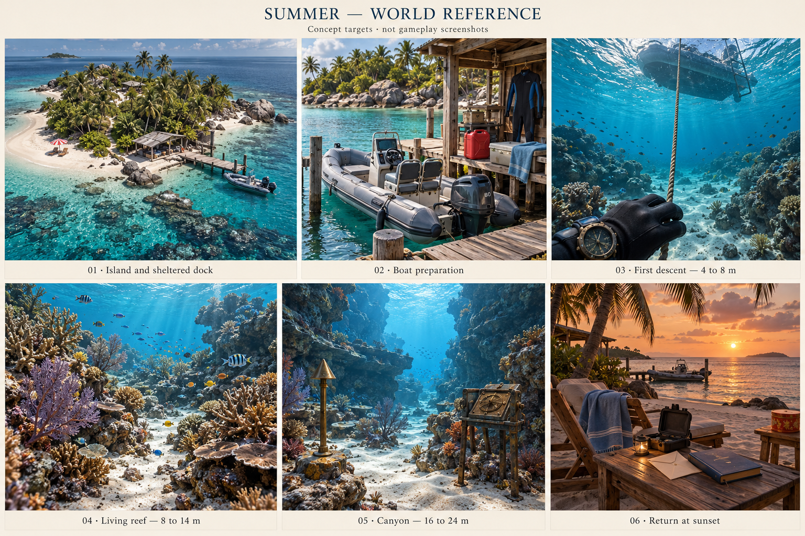
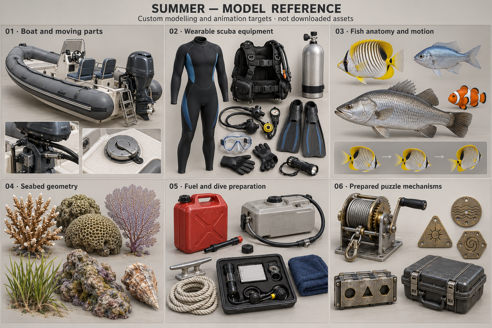

# Summer — The Days We Haven’t Had Yet

Completed design and implementation handoff · 22 October 2026

**Status: planning complete; Summer expansion is not implemented or playtested.** This resumes the interrupted **Plan summer underwater exploration** chat. Its research and two generated concept sheets survived; no completed Summer specification was saved. This document completes that specification, following the current request to finish planning. The earlier request to implement and visually test is retained as the execution sequence below, not reported as completed work.

## 1. The experience we are building

Aami arrives on a larger, warm coastal island, prepares a small motorboat, puts on real scuba equipment, travels to a sheltered dive mooring, and explores a living reef and an open underwater canyon. She solves physical puzzles placed there by Shyamu, retrieves a sealed keepsake case, and returns to two chairs on the beach to open it. The reward is a personal letter about the ordinary future he wants with her and access to the Summer book.

**The message:** “I want more of the small things with you. I want to make room for you in my days, take care of you, and keep choosing time together.”

Target a **49–65 minute first playthrough**, with approximately 55 minutes as the pacing goal. This is an estimate to validate with a first-time player, not a forced minimum. Repeat players and players using solutions can finish sooner. Do not pad the journey with long drives, oxygen refills, item grinding, or mandatory waits.

The underwater world should feel substantial and believable: textured three-dimensional fish, coral, sand, rock shelves, a water surface overhead, soft moving light, and depth that remains inviting. “Deep sea” here means the deeper part of this explorable island reef, approximately 16–24 m below the surface, not a scientifically literal abyssal environment.

### Decisions recovered from the previous conversation

- Spring expresses the love he gives her now and the comfort he receives from her. Summer expresses their future warmth. Leave Winter’s goodbyes and promises to Winter.
- Use the most realistic suitable free models available; create or improve models and animate them ourselves where necessary. Fish and interactable objects must have actual 3D geometry.
- She is likely to play on a phone. Desktop and mobile must both work. English is acceptable; she also understands Malayalam/Manglish.
- She prefers happiness, reassurance, and that soft sunlight after rain. No horror atmosphere.
- Keep the writing romantic but natural. The user explicitly rejected dramatic, artificial notes during Spring.
- Include visual references so another agent can implement the same world rather than reinterpret the plan.

### Personal continuity

These details were checked against the user’s original Spring answers, not inferred from the generated pictures:

| Shared memory | Summer’s future expression | Where it appears |
| --- | --- | --- |
| Best friends through chats before a mutual confession by phone | Ordinary conversation still matters | Opening note and final letter |
| Finding opportunities to meet across distance | Make time for shared days | Preparing a day out and returning together in spirit |
| One train seat and *Pachai Nirame* | Make room for two | Two boat seats, the equipment kept off the second seat, two beach chairs |
| Feeding her orange laddoo on the bus | Remember small preferences | A restrained tin beside the final seating area |
| Resting with his head in her lap by the water | Offer the same patience and comfort | Observation puzzle that rewards slowing down, quiet place at the end |
| Money plant, hair clip, candle, yellow note, sky-blue round hair accessory with golden thread | Care for things entrusted to him | Blue towel, fine brass details, protected letter; no replicas of every Spring gift |

All new notes below are drafted for this gift. They are not historical quotations or invented messages from Aami. The island is a prepared fictional experience, not a claim that they have already taken a diving holiday. Do not invent an engagement, wedding, children, home purchase, dates, or a reply from her. Family objections and the interrupted contact period do not become enemies, gates, or punishments.

## 2. Visual references and how to use them

[Open full world reference](docs/summer/reference/summer-world-reference.png)

[Open full model reference](docs/summer/reference/summer-model-reference.png)

These are AI-generated **concept targets**, recovered from the previous chat and visually inspected during this planning pass. They are not gameplay screenshots, downloaded models, engineering drawings, or evidence of achievable frame rate. They belong in documentation, not as flat replacements for explorable scenery. Generation provenance is retained in [the reference notes](docs/summer/REFERENCE-NOTES.md).

Use the world board for composition and material relationships: a recognisable island above water, pale sand between coral clusters, an overhead boat at the first descent, a readable open canyon, and a modest beach ending. Use the model board for proportions and finish. Inspect every actual asset in the runtime lighting before accepting it.

**Written specifications take precedence where the concept art differs:** the final three route plates are equal-size square plates, not three obvious shape-matching keys; the underwater case stays closed until it reaches the beach; puzzle machinery is mounted on stands in clear sand, never bolted into live coral; remove any generated brand markings. The boat must have its specified ladder, seats, fuel assembly, and mooring points even if a source model omits them. The board’s reef density is a composition goal, not a requirement to fill every metre with high-detail coral.

## 3. Current code and required architectural change

The checkout uses a shared Three.js renderer and authored seasonal scenery. Keep that architecture. Do not rebuild Summer as Unity, introduce a second canvas, or revive the retired monolithic seasonal `.blend` pipeline.

| Inspected component | Current behaviour | Summer change |
| --- | --- | --- |
| `app/shrine-void/season-layout.ts` | Summer heightfield, plants, obstacles, a shallow-water walking grid | New Summer-specific island and seabed layout; regenerate bounds and clearances together |
| `season-terrain.ts` | Summer terrain chunks currently span x/z ±64 m | Extend/chunk for the new layout; provide real seabed and separate canyon wall geometry |
| `season-navigation.ts` | Grounded walking, 28 cm clearance, wading, horizontal controls | Preserve for land; add a separate boat controller and 3D swim controller behind a shared input adapter |
| `season-ocean.ts` | Coastal surface rendering | Retain shore effects; add a coherent underside and underwater transition, with actual seabed below |
| `season-world.ts` | Loads scene assets; integrates Spring state/UI; creates ordinary seasonal relics | Integrate Summer state, world, interaction targets, streaming, controller mode and reward gating |
| `void-scene.tsx` | Routes inputs to active travel controller; Spring overlay and shared reader | Add Summer overlays, mode-specific controls, input reset, focus and touch handling |
| `season-book-data.ts` | Part Two lookup; creates blank fallback pages if absent | Keep existing artwork; implement a proper missing-content state for Summer rather than presenting blank pages as the prize |
| `season-relic-state.ts`, `season-relics.ts` | Existing key/chest/book progression | Disable Summer’s old beach-key shortcut; integrate the case reward without breaking other seasons or old reader progress |

The working tree already contains unrelated Spring and seasonal work. Preserve it. The proposed files below are additions, not files that already exist.

## 4. World layout and physical placement

Use metres, Y up, water mean level `y = 0`, north `-Z`, east `+X`. The table is the authoring layout for a blockout; final shoreline and contact heights must be checked against the generated geometry. Do not scale all current props with the island.

Enlarge the dry island to an irregular footprint of roughly **100 × 120 m**, with actual clear walkable routes and a sheltered eastern bay. Keep the existing recognisable chairs, palms and beach materials, relocating them with measured ground contacts. The reef extends eastwards. The active world envelope is approximately `x [-70, 230]`, `z [-90, 90]`, `y [-30, 40]`; renderer bounds, navigation, ocean coverage, fish volumes and chunk culling must agree.

| Area / ID | Proposed centre (x, z) | Elevation / depth | Placement and purpose |
| --- | --- | --- | --- |
| Arrival `S0` | (0, 8) | Terrain + eye height | Clear view of note and coastline; retain accessible return to blossoms |
| Sunset chairs `S1` | (-20, 2) | Dry terrain | Chairs facing west; small table with two clear approaches, final case rest, towel and tin |
| Island lookout `S2` | (6, -30) | Terrain approximately +4 m | View of bay and mapped landmarks; walking trail at least 1.8 m clear |
| Equipment shelter `S3` | (32, -8) | Floor approximately +1.0 m | Wetsuit rack, labelled tray, fuel shelf; roof, posts and colliders align |
| Jetty `S4` | (45, -8) | Deck approximately +0.8 m | Connected to land; posts enter seabed; 2 m clear walking strip; no stepping across open water |
| Boat berth `B0` | (49, -8) | Floating at waterline | Hull alongside dock, boarding socket, shore cleat and stowage |
| Outbound channel `B1` | (72, -15) | Surface | Clearly placed floating buoys; ≥12 m wide, sufficient water under the hull |
| Dive mooring `B2` | (106, -24) | Surface / 7 m seabed | Buoy, mooring line and separate descent line to a sand anchor; overhead boat remains recognisable |
| Training shelf `U0` | (106, -24) | 4–8 m | Safe open swim loop, sand, low coral, first route post |
| Observation garden `U1` | (126, -37) | 8–11 m | Three distinct coral silhouettes on a curved sand route; puzzle on sand |
| Sheltered fork `U2` | (151, -17) | 12–17 m | Three open passages with stable current indicators and visible exits |
| Winch terrace `U3` | (173, -28) | 18–21 m | Prepared demonstration rig and case carriage, sufficient clear swim space |
| Case plinth `U4` | (181, -28) | 20 m; nearby seabed down to 24 m | Mechanism opens keeper; still reachable without entering enclosed rock |

Return route follows the marked sand corridor to `U0`, then the descent line and stern ladder, then the same channel home. The boat stays moored while diving. Never move it to match the player offscreen.

Geometry rules: sand gaps at least 2.5 m wide along the main swim route; no required tunnel narrower than 2 m; no overhead enclosed cave; stations readable from 1–2 m with space to stop. Bury rock bases slightly, place coral bases on substrate and keep floating coral out. Scatter shells on sand with believable size and orientation. Live fish are never stranded on land or able to swim through the dock, hull, terrain or puzzle rig.

The player may explore out of order, but each station explains any missing tool. Gates restrict a prepared mechanism, not the surrounding ocean. The final case is visibly secured, so swimming around a puzzle cannot collect it early.

## 5. Full journey and pacing

| Act | Experience | First-play estimate |
| --- | --- | ---: |
| 1 | Arrival, opening note, route chart assembly | 5–7 min |
| 2 | Boat fuel, luggage stowage, equipment fitting | 6–8 min |
| 3 | Pilot the channel, moor, descend and learn movement | 5–6 min |
| 4 | Reef observation and first route plate | 7–9 min |
| 5 | Current-route puzzle and second plate | 7–9 min |
| 6 | Cable-routing / load-transfer puzzle and third plate | 8–10 min |
| 7 | Assemble the route cassette, release the case | 5–7 min |
| 8 | Return, beach reveal, letter and book | 6–9 min |
| **Total** | Includes exploration and reading, excludes long manga reading | **49–65 min** |

Do not enforce these times. Optional fish watching, a lookout, sitting, and rereading can extend the visit. If a first-time player takes under 40 minutes, improve the meaningful investigation and optional environmental discoveries; do not add timers or increase swimming distances just to inflate length.

## 6. Puzzle script, solutions and fairness

Every puzzle has an authored physical reason to exist: this is a trail prepared by Shyamu. A route board at the shelter explains that the small stations are part of his gift. No mysterious ancient temple or arbitrary ocean-wide lock.

Use persistent journal entries with enlarged diagrams. Clues must work without remembering personal facts, hearing audio, distinguishing colours, or guessing the developer’s intended camera angle. Personal recognition adds feeling; the in-world evidence supplies the answer.

### Act 1 — A day we have time for

Opening note, visible on the beach table from the arrival path:

> Aami, I wanted to make us a whole day with nowhere else to rush to.
>
> There’s a boat in the little bay. I’ve left the route in two pieces—one here, and one at the lookout. Bring them to the table by the equipment shed.
>
> We’ll come back to these chairs afterwards.

The first chart half has the island shoreline, a north arrow and registration marks. The second sits in a weatherproof box at the lookout named on a simple island sign. Both are guaranteed visible objects, not buried pixels.

**Puzzle:** join the two transparent chart halves on the shelter table. Match the duplicated jetty outline and two labelled registration crosses, then rotate the assembled chart to north. This produces one uninterrupted channel from the jetty, past the outer buoy, to the dive mooring. Four possible rotations are offered, plus slide/snap or select-and-place controls.

**Exact solution:** first half upright in left tray; second half upright in right tray; match upper cross `A` and lower cross `B`; north arrow points toward the table’s fixed `N`. The completed channel reads `JETTY → OUTER BUOY → DIVE MOORING`. Incorrect rotation cannot align both marks. The displayed geometry and validator must use the same authored diagram data.

**Output:** completed chart in journal; route plaque at the boat gains a clear preview; gear shelf opens. Reward for exploring the lookout is a view and useful information, not another code.

**Hints:** “The two sheets share a piece of coastline.” → “Match both A and B, then check north.” → show the solved placement. The inventory retains the pieces if she leaves midway.

### Act 2 — Getting ready, with room for two

The boat has two seats. The second initially holds a dry bag. A note attached to its strap says:

> We managed with one seat once. I thought we could have two this time.
>
> The bag fits under the console. Your towel is inside.

**Boat preparation:** inspect the console checklist; stow the bag in its fitted compartment; collect the red fuel can from the dock shelf; open the tank cap; fit the spout; perform a short pour; replace cap; attach the engine supply hose to its matching socket; return the can to its dock bracket. The gauge visibly rises and the checklist updates. Fuel transfer is a brief game interaction, not a real-world procedure simulator or a repeated resource economy. The prepared fuel lasts the whole chapter; “Return to mooring” prevents becoming stranded.

**Equipment sequence:** wear wetsuit at the shelter, equip BCD/cylinder/regulator, check the visible connected assembly, collect mask, fins, torch, compass and slate into the boat’s fitted tray. Mask and fins are fitted at the mooring while seated. A clear mannequin/gear inspection view shows the suit before fitting, and looking down shows sleeves, gloves and later fins on the player. A fade alone or an inventory tick alone does not satisfy “wearing the scuba suit.”

**Logic:** departure requires chart, stowed bag, completed fuel assembly and onboard gear. Diving requires the boat moored, engine stopped, ladder down, wetsuit/BCD/regulator equipped, mask and fins fitted, and slate/compass/torch available. Missing conditions produce specific instructions and visible locations, not “invalid action.” No specialist knowledge is required: every connection is labelled and shown on the tray diagram.

**Output:** access to boat controls and completed departure checklist. Leaving/reloading restores each completed step. Cap and hose operations are idempotent; fuel cannot duplicate or become negative.

**Hints:** point to the visible checklist → highlight the next incomplete assembly → offer “Help me finish preparation,” with the same physical completion animation and no punishment.

### Act 3 — The first descent

Pilot through the wide marked channel. Buoys use words and distinct stripe counts. Controls explain slow steering and reverse. Near the dive buoy, reduce speed and choose “Moor”; the boat aligns and visibly attaches its line. Stop the engine and lower the ladder. Put on mask/fins, inspect the complete gear and choose “Enter water.”

Use a short controlled entry with visible hand contact and a stable camera. She can descend along the rope at her own pace. Teach forward, turn, ascend and descend with three nearby route posts. The last post reads:

> The next part is beside the three coral shapes. You can take your time here.

No oxygen countdown, death, panic warning, current sweep into darkness, or mandatory simulated decompression. The wrist instrument shows depth, direction and a simple equipment-ready indicator. This is an exploration game with simplified diving. Surface/boat recovery is always available; swimming off-route receives a gentle boundary cue.

### Act 4 — Notice the little things

At the observation garden a slate explains: “Compare the three silhouettes from the numbered sand markers. Turn the dials to the shapes you see.” It includes diagrams for **branch**, **fan**, **mound**, and **table** coral. These names describe the authored silhouettes, not species-identification questions.

Three numbered observation frames sit on stands along a short curved route. Each frames one deliberately different coral grouping. Fish move naturally through the area, flee when approached, and return when given space. Fish are atmosphere and feedback, never the only way to reveal a clue.

**Puzzle:** inspect frames 1–3, record the silhouettes, then set three mechanical discs on a small locker. Each disc has a matching raised shape plus a readable word. Rotate by dragging or labelled left/right buttons. Journal automatically records each inspected frame, including the enlarged static silhouette.

**Exact solution:** frame 1 = **FAN**; frame 2 = **BRANCH**; frame 3 = **MOUND**. Start positions are MOUND / TABLE / FAN. Set discs in numbered order and pull the locker lever. A complete, correct set opens the locker and reveals route plate `P1` plus a fitting handle for the next station. Wrong attempts leave everything accessible and say which numbered frame to revisit, without revealing the answer immediately.

**Narrative slip:** “I liked how you let me stay there by the water without needing me to say anything. I want you to have that with me too.”

**Hints:** “Use the numbered frames; the order matters.” → “The first has a broad, flat fan.” → show FAN / BRANCH / MOUND with matching diagrams. An “Inspect view” button reproduces the intended framing for a player who cannot align the camera. Coral growth, lighting, LOD and fish occlusion must not change the answer.

**Output:** `P1`, handle, recorded silhouettes, next station labelled on the slate. No coral is picked, broken, or used as a switch.

### Act 5 — Find the quieter way

At the fork, use the handle to unfold a prepared route board. Three connected route segments on the board correspond to three junctions in the real sand corridor. Each junction offers **A**, **B**, or **C**, with words engraved on posts. Moving ribbons indicate direction; fixed arrows and an enlarged diagram carry identical information for reduced motion.

The goal printed on the board is: **“Find a route with the current at your back that passes the sheltered rest ledge before the winch.”** This is a route-planning puzzle, not a reflex challenge. No current can damage the player or make a chosen route impossible to exit.

| Junction | A | B | C | Correct |
| --- | --- | --- | --- | --- |
| 1 | Opposing arrow, ends at overlook | Following arrow, reaches junction 2 | Following arrow, loops to start | **B** |
| 2 | Following arrow, passes REST ledge | Following arrow, bypasses REST | Opposing arrow, loops to junction 1 | **A** |
| 3 | Following arrow, returns to mooring | Opposing arrow, reaches winch | Following arrow, reaches WINCH | **C** |

**Puzzle:** trace the route with three sliding pointers, then traverse it to the rest ledge. Board and in-world paths are generated from the same route graph. **Exact solution B → A → C.** The board confirms each connected segment only after submission, shows where a wrong route ends, and permits unlimited correction.

The rest ledge locker releases `P2` once she arrives with the correct route recorded. This avoids a remotely opening invisible chest. Its note reads: “Some days we’ll have plenty of energy. Some days we’ll take the easier way. I still want the day with you.” The ledge has a broad view and room to pause; no forced rest duration.

**Hints:** “A following arrow is not enough; look at where the path ends.” → “Your route needs REST before WINCH.” → show B / A / C. She can inspect the whole board without physically swimming every wrong branch. Searching unexplored areas never removes a collected plate.

### Act 6 — A little help with the heavy part

On a clear sand terrace, a small intentionally prepared hoist holds a case carriage below its access ledge. A transparent guard exposes the pulleys and the load path. The movable pulley is visibly attached to the carriage. Two fixed guide pulleys are on the stand. A printed diagram uses the same labels as the physical parts.

Instruction: **“Start at FIXED END. Go under the pulley attached to the load, over the top guide, then into the drum. Take the weight before releasing the catch.”** All equipment is a fictional low-load puzzle installation; it is not a lifting tutorial for real equipment.

**Puzzle part A:** select the rope end, then select the sockets in sequence. Use click/tap selection or drag; the resulting 3D rope visibly reroutes. Non-valid routes remain previews and do not entangle scenery.

**Exact cable route:** `ANCHOR → LOAD PULLEY (under) → TOP GUIDE (over) → DRUM`. A second fixed pulley is labelled `SPARE`; its mount holds the return line and does not enter the load path. The diagram makes that distinction explicit rather than making a duplicate pulley an arbitrary decoy.

**Puzzle part B:** turn/tap the crank until the tension needle is within the marked `SUPPORTED` band; release the retaining catch; crank the carriage to the ledge; engage the visible locking pin. Use text and needle position as well as colour. Pointer-down, repeated taps, and a keyboard action all work. No rapid clicking, narrow timing window, or prolonged holding.

If she releases the catch without taking the weight, it remains mechanically engaged and a message points to the tension gauge. An attempted wrong cable route cannot advance the lift. Once supported, the load remains supported until intentionally lowered. Pausing freezes the mechanism.

The carriage rises over about 6 seconds of total crank action. Pulley rotation and rope payout match carriage displacement; the two supporting rope segments imply twice the carriage displacement in the winding length. Keep the simplified simulation internally consistent.

**Output:** the carriage is pinned safely in place, `P3` is available in its tool tray, and the case keeper/cassette can be reached. The case itself remains held by the keeper until Act 7.

Note beside the crank: “You’ve looked after me in ways I still think about. I want to be someone you can lean on too.”

**Hints:** “The pulley on the load has to be in the rope path.” → highlight ANCHOR, LOAD, TOP, DRUM in order → demonstrate routing and the support/catch/pin sequence. The player can undo or reset this mechanism without resetting the adventure.

### Act 7 — Put the day together

The three plates are equal-size square brass tiles with shallow engraved route lines. They depict the route through the observation garden, rest ledge and winch. They fit any of three slots; shape alone does not give away the solution. Each tile has a clear north arrow, a numbered stop label and large route endpoints.

The cassette reads: **“Put our stops in the order you visited them. Keep north up. Join the route from START to RETURN.”**

**Exact solution:** `P1 (GARDEN) → P2 (REST) → P3 (WINCH)`, all north-up. In the solved strip, the start rail connects to the left-centre of P1; P1 exits right-upper; P2 enters left-upper and exits right-lower; P3 enters left-lower and exits right-centre into RETURN. Slots do not allow flipping, only rotations of 0/90/180/270 degrees. Marks and line endpoints make the solution independently deducible; all plate images derive from this single layout specification.

**Action:** place/rotate tiles, then pull the release lever. Only the complete continuous route with correct ordering and north-up releases the keeper. The line highlights section by section and the physical keeper opens. The sealed case can now be clipped to the player’s harness. It does not float in front of the face and obstruct swimming.

**Failure:** plates remain removable; the journal shows the recorded journey. If a tile is dropped, it returns to the slate pouch or its nearby holder. Missing plates produce “Find the plate at [named station]” once that station is known, not a dead lever.

**Hints:** “This is a map of the places you visited.” → “Garden, rest ledge, then winch; check the arrows.” → show the complete strip. The prior concept art’s circle/triangle/hexagon key arrangement is superseded by this design.

The case label says: “Bring this back to our chairs. The letter is dry inside.” The lid remains latched underwater; a clear “Open on the beach” prompt prevents pretending paper can be read underwater.

### Act 8 — Back to the chairs

Follow the marked return path or select the optional guided return to the descent rope. Ascend, use the lowered ladder, remove fins at the boat, release the mooring and return through the channel. Docking offers the same forgiving alignment assist. Remove the gear at the shelter and place the case on the beach table.

The sky warms gradually during the return. Do not snap the sun position, darken the reef while she is reading clues, or create an artificial storm. Both chairs remain available. The tin and towel are small details, not additional locks.

Open two visible case latches; the lid hinges back; the dry envelope and blue book sit in shaped padding. Read the letter at a comfortable size. New draft:

> Aami,
>
> I keep thinking about how much I liked doing ordinary things with you. Sharing that seat on the train. Feeding you laddoo on the bus. Lying beside the water with my head in your lap.
>
> I want more days like that. Days when we can go somewhere together, and days when we don’t need to go anywhere at all. I want to hear how your day went without already counting the time until I have to leave.
>
> You’ve made me feel cared for. I want you to feel that with me too—in the little things I remember, in making time, and in being there when you need a quieter day.
>
> I don’t know every detail of what comes next. I do know I want to keep making room for you in it.
>
> For today, I left us two chairs. Come sit with me for a bit.
>
> Shyamu

This is a draft written in his voice, grounded in his stated intent. The player is never asked to prove love by solving quickly, and the end does not require sending a message, making a promise, or giving personal information.

**Book content rule:** if real Part Two pages exist in `manga-data.ts`, open them through the existing reader and preserve page progress. If absent, the completed letter is the immediate reward; display a small explicit “The Summer chapter hasn’t been added yet” action state. Do not generate substitute manga or silently show 25 blank pages as a finished chapter. The final case/letter/revisit scene still works. Actual Part Two artwork remains a content dependency for calling the manga portion complete.

## 7. Controls, comfort and accessibility

| Mode | Desktop | Touch | Important behaviour |
| --- | --- | --- | --- |
| Walk | Existing WASD/arrows and drag look | Existing joystick and separate look region | Preserve current ground controller and pickup controls |
| Boat | W/S throttle/reverse; A/D steer; drag look | Joystick throttle/steer; independent look | Ramp acceleration, limited turn rate, no camera roll; boarding/exit only at valid anchors |
| Swim | WASD horizontal; Space up; Ctrl or C down; drag look | Movement joystick; separate Up/Down hold buttons | Vertical input is explicit; looking up does not unexpectedly accelerate ascent |
| Interact | Existing Enter / interaction button; optional E alias | Large single-tap labelled Interact | Preserve existing double-tap support, but never require it for Summer |
| Puzzle | Tab focus, arrows, Enter; drag optional | Tap-select/tap-place and rotate buttons; drag optional | Block movement while manipulating a mechanism or reading |
| Journal / recovery | Dedicated UI controls; Escape closes current overlay | Persistent slate and pause controls | Recovery, hints and return remain discoverable |

Swim starts near 1.3 m/s horizontal and 0.65 m/s vertical, tuned after playtesting. Boat cruise starts around 4 m/s with a low-speed docking mode. These are initial gameplay values, not realistic vehicle or diving specifications. No sprint requirement. Use frame-rate independent acceleration and bounded collision substeps. The player never rolls with the camera.

Use a capsule proxy for swimmer collisions and a simplified hull proxy for boat collisions. Combine seabed height samples with separate colliders for canyon walls, coral clusters, dock and mechanisms. A heightfield alone cannot handle overhangs. Sweep movement to avoid tunnelling; slide against obstacles; do not teleport through coral when moving at low frame rates.

Pause and reader overlays freeze controls, pressure-free puzzle simulation and camera drift. On blur, pointer cancellation, orientation change, overlay opening, entering/leaving water and world exit, clear every held input. Preserve the existing landscape layout requirement and check the guidance overlay does not trap control focus.

Text must remain legible at 844×390 and narrow landscape sizes. Targets should normally be at least 44 CSS px. Mirror engravings in enlarged UI; do not rely on texture pixels alone. Provide subtitles/text for every meaningful sound. Reduced motion removes camera bob, heavy water distortion and rapid caustics while retaining labelled arrows, readable water boundaries and mild fish movement. Each puzzle offers clue, clearer clue and explicit solution on request; hints do not erase rewards.

## 8. Wildlife and underwater rendering

**Actual meshes:** at least three visually distinct fish body types with credible anatomy and materials, plus several coral/rock forms. Import GLBs or export our own authored Blender models as GLBs. No flat fish cards, extruded photographs, or primitive spheres accepted as final animals. Source availability and appearance are separate acceptance gates; see [the asset register](docs/summer/ASSET-REGISTER.md).

For each fish, normalize forward axis and metre scale; create a 4–7 bone spine/tail rig with weighted tail motion and independent fin motion where visible. Author idle-swim, cruise, startle, turn and settle behaviour. Blend tail frequency/amplitude with actual speed, offset phase per individual, keep the head steadier than the tail, and avoid sliding a rigid fish along a curve. Static source fish need our rigging pass; no source animation is assumed.

Fish state sequence: `wander/school → alert → flee → recover → wander/school`. Initial tuning: notice a moving player around 3 m, flee around 1.5–2 m or on deliberate nearby interaction, choose a free direction away from the player and obstacles, accelerate for roughly 1–2 seconds, then ease down after several seconds at safe distance. Species and individual thresholds vary. Clicking/tapping near a fish causes a brief local response, not an entire ocean fleeing simultaneously. No grabbing or harming wildlife.

Schooling uses separation/alignment/cohesion with a bounded spatial neighbourhood, acceleration limits and turn-rate limits. Select habitat volumes and sample collision-free targets. Fish avoid the surface, bottom, coral, hull and the player. Check a proposed flee target and route before accepting it. There is no teleporting in view, synchronized turning of every fish, or instantaneous 180-degree body flip. No puzzle solution depends on random fish behaviour.

Initial density: desktop 40–60 fish nearby, compact 16–24, with only 6–10/3–5 fully animated close fish respectively. Use instanced, mesh-based deformation for farther fish if needed; preserve silhouettes and material quality. Cull by habitat cell and visibility; do not update every fish in the entire ocean every frame. A skinned clone must own its pose correctly; shared geometry/material disposal must remain safe.

Underwater look: a real sand floor and walls, depth/distance colour attenuation, a slight blue-green haze, a visible surface underside and moving shallow caustics. Keep near coral colours readable and reduce warm wavelengths with distance rather than tinting the entire screen uniformly blue. The torch lights the immediate target; it does not become a giant spotlight visible through rocks. Use subtle suspended particles with bounded counts. Alpha fish fins and sea fans need sorting checks. Geometry and 1K/2K PBR maps do the visual work; bloom cannot hide poor models.

Blend surface and underwater state over a small band with hysteresis so waves near the camera do not flicker the mode. Keep the horizon above water and proper underwater occlusion below. Use the same water height convention for hull buoyancy, swimmer limits, foam and underwater colour. Start with a bounded lightweight approach; expensive volumetrics, full-scene realtime reflections and many shadow-casting lights are outside the base implementation.

Audio: reuse licensed coastal ambience; add original or properly licensed restrained breathing, bubbles, outboard, metal/rope contact and latch sounds. Fade/filter by camera medium, stop engine sound underwater when engine is off, and pause/stop loops on world exit. Song title references may appear in prose; do not add an unlicensed recording of *Pachai Nirame*.

## 9. State, save and recovery contract

One Summer controller is the authority for puzzle progress. UI, mesh poses, journal, inventory and interaction eligibility derive from its validated state. Never store progress independently on a 3D object and in React.

Suggested save key: `between-seasons-summer-v1`. Save only completed durable actions, with a versioned schema, not raw object references, velocities, mid-pour animation time or a half-open latch. Store:

- chart pieces and chart assembled;
- boat fuel completion, hose/cap/stowage checks, equipment ownership and fitted state;
- observation records and solved discs;
- route recorded and rest ledge reached;
- cable route accepted, carriage raised and pinned;
- unique plate IDs, cassette released, case recovered;
- returned to shore, letter opened, book unlocked;
- checkpoint ID, boat anchor ID, journal/hint progress and accessibility preferences.

Transient `mode` is `walking | boarding | boating | mooring | gearing | enteringWater | swimming | climbing | docking | reading`. Restore at a stable checkpoint appropriate to durable progress. An interrupted animation replays or restores its last completed endpoint, without duplicating an item.

| Restore situation | Safe result |
| --- | --- |
| Refresh during preparation | Shelter; completed fuel/gear steps retained, unresolved props at fixed holders |
| Refresh while boating | Last valid berth/mooring; no boat stranded on land or open sea |
| Refresh while diving | Most recent valid underwater route post, boat at dive mooring, equipment ready |
| Refresh during crank/cassette action | Stable supported mechanism state; plates and case have one owner each |
| Refresh after case retrieval | Case attached to harness or in boat stowage; never loose under terrain |
| Return to blossoms and re-enter | Resume prompt; preserve milestones and current safe checkpoint |
| Corrupt or future-version save | Recover known valid progress conservatively or offer a clear reset; keep unrelated season saves |
| Storage unavailable | Session play works; visible “Progress cannot be saved on this device” notice, no crash |

Critical items cannot be lost. Decorative pickup uses the existing system; plates, tools and case use explicit inventory ownership and safe sockets. “Return to last route post,” “Return to boat,” and “Return to island” retain completed puzzles. Returning early does not award the case or bypass its prerequisites. At the boat, equipment can be refitted without replaying every animation.

Migration from the old Summer relic save: preserve any already acquired book/reader access. Offer the new trail as a replay without revoking past access or awarding puzzle milestones. New visitors must complete the new case sequence for its reward. Reset Summer affects only its new trail save unless the user deliberately chooses a broader reset.

## 10. Asset and performance budgets

All numbers are provisional acceptance budgets, not measurements. Choose quality by measured render cost plus device signals, preserving readable clues at every quality level.

| Metric | Desktop target | Compact target |
| --- | ---: | ---: |
| Sustained representative gameplay | Around 60 FPS | At least 30 FPS on tested target phones |
| Visible triangles | ≤700k | ≤300k |
| Draw calls | ≤140 | ≤90 |
| Loaded textures, estimated decoded GPU footprint | ≤256 MiB | ≤128 MiB |
| Summer entry download | ≤15 MiB | ≤10 MiB |
| Additional underwater content | ≤20 MiB, staged | ≤12 MiB, staged |
| Typical textures | 1K; selected 2K hero details | 512–1K, readable clue UI separate |

Load shore/boat first, prefetch the training reef when preparation is nearly finished, then stream deeper cells ahead of travel. Never freeze the player at a blind loading boundary. If a required cell fails, keep her in the last loaded area with retry/return controls. Cancel downloads and ignore late results after leaving the season. Test shader compilation as well as transfer size. Reuse rock/coral geometries, atlas compatible materials, and instance repeated scenery in spatial cells.

If budgets fail, first reduce distant fish updates, particle count, shadow work, far coral density and render resolution within limits. Preserve collision geometry, clue readability, fish silhouette and near interaction models. Do not secretly replace requested 3D animals with sprites. Archive source models and editable rigs outside `public`; ship optimized runtime files only.

## 11. Implementation sequence and deliverables

### Phase A — Asset acceptance and a playable section

Download/import the selected candidates, capture their source/license records, inspect geometry and materials, and reject unsuitable ones. Complete the custom-model work explicitly listed in the asset register. Build one boat, one equipped player view, one reef cell, three fish body types and one usable underwater station before constructing the full route. The boat must have functional independent parts, and fish must visibly bend and avoid the player. This gate establishes visual feasibility on desktop and compact settings.

### Phase B — Layout and controllers

Create `summer-layout.ts`, `summer-boat.ts`, `summer-swim.ts`, `summer-underwater.ts` and a movement-mode adapter. Expand Summer only, including terrain, navigation, scatter, water, colliders, spawn/exit and culling bounds. Verify walking → boarding → driving → mooring → gear fitting → swimming → ladder → boat → dock → land before adding puzzle complexity.

### Phase C — State and physical puzzles

Create `summer-state.ts`, `summer-puzzle-data.ts`, `summer-world.ts`, `summer-ui.tsx` and `summer.css`. Keep the puzzle diagram data canonical so artwork, answer validation, labels, hints and journal cannot drift. Implement all eight acts, save schema/migration, inventory ownership and explicit recovery. The world should remain traversable even if a puzzle overlay closes midway.

### Phase D — Wildlife, scene finish and ending

Create `summer-fish.ts`; finish local fish behaviour, reef distribution, underwater lighting, wave boundary and sound transitions. Author the return, gear removal, sealed-case opening, letter and book eligibility. Use existing chapter assets only. Add visible attribution for every final third-party asset.

### Phase E — Verification and release preparation

Run the focused checks below, complete an unassisted first-play walkthrough, record timings, repair failures and repeat only affected checks. Capture real runtime screenshots next to the concept targets. Record the exact build/revision and device/browser used. Publish only as part of an implementation/release task using the existing project’s workflow; a completed planning document is not a deployed Summer experience.

Proposed new runtime assets: `public/seasons/kit/summer/` with boat, gear, mechanism and wildlife subfolders plus a manifest of filenames, source IDs, dimensions, LODs, animation clips, texture memory estimates and checksums. Proposed offline scripts: `prepare-summer-assets.mjs`, Blender authoring/export scripts, and `audit-summer-assets.mjs`. Keep authoring files under `Assets and working files/seasons/summer/`.

## 12. Verification and definition of done

### Automated checks to write during implementation

- State transitions: reject diving without fitted gear/mooring, disallow early case release, permit exactly one ownership instance per plate/tool/case, prevent double fuel completion, validate all puzzle solutions and representative wrong answers.
- Save/reload: round-trip every stable checkpoint, interrupt each transition, corrupt saves, storage errors, old Summer book migration, repeat entry and exit. Recovery must preserve rewards and never manufacture progress.
- Navigation: route connectivity, dock/boat boarding clearance, water boundaries, seabed clearance, wall collision, no tunnelling at 30/60/120 Hz, mode-switch input reset and grounded decorative props.
- Wildlife: bounded speed/acceleration, obstacle-respecting flee paths, no above-water fish, no NaN positions, no progression dependency on fish randomness.
- Assets: required files load with textures; dimensions/pivots/colliders/clip names correct; no missing normals, unexpected external URLs or orphaned textures; final credits match actual imported files.
- Run existing affected regression scripts: `test-season-navigation.mjs`, `test-season-layout.mjs`, `test-season-assets.mjs`, `test-season-water.mjs`, `test-water-contacts.mjs`, `test-season-pickup.mjs`, `test-season-books.mjs`, `test-spring-trail.mjs`, `test-spring-classroom.mjs`. Run TypeScript and the project build using its configured workflow.

### Actual visual and gameplay walkthrough

1. Fresh save: enter from the hub; follow only visible clues, inspect the island/lookout, assemble chart, fuel and board. Record confusing instructions and misplaced objects.
2. Inspect boat at dock, underway and moored: waterline, hand contact, seat access, engine/propeller alignment, ladder length, rope attachment, wake and collision.
3. Inspect gear on rack, equipped view, water entry and ladder return. No floating equipment, disappearing body parts, hose-through-camera or fins worn while walking on shore.
4. Observe the reef from above, at waterline and below. Check surface underside, depth readability, coral grounding, contact shadows, rock seams, alpha sorting and torch response.
5. Watch fish idle, school, flee and recover from several approach angles. Check anatomy and tail deformation close up. Fish must not intersect terrain, the boat or each other persistently.
6. Solve every puzzle by its in-world evidence. Deliberately choose wrong routes, close overlays, drop items, leave a station and return. Check the exact solution tables against visible art. Every hint level must remain available and understandable.
7. Recover case, return, dock, open letter/book; replay the ending and reload. Check absent Part Two content separately from a build with actual pages. No legacy beach key may bypass a new player’s trail.
8. Phone landscape and desktop: test both thumbs, tap-place alternatives, focus, orientation interruption, backgrounding, reduced motion, sound muted, and 200% text zoom where feasible. Emulation verifies layout; physical Android/iOS devices are required for performance claims.
9. Cold load, failed asset, cancellation, context loss and five complete enter/exit cycles: no stuck curtain, leaked loops, orphaned controls or steadily growing GPU resource counts. Inspect console and network failures.
10. Measure a first-time playthrough without solution spoilers. Aim for 40+ minutes of interested exploration with completion normally inside 65 minutes. Separate navigation confusion from productive puzzle thinking; fix confusion rather than counting it as successful duration.

Required evidence set: island overview, preparation close-up, equipped view, surface/underwater crossing, reef close-up, fish motion clip, each solved mechanism, case recovery, beach ending, compact UI screenshots, walkthrough timing and performance observations. Store it under a dated `output/summer-qa-*` folder during implementation. Static screenshots cannot certify motion, collision, controls or saves.

**Completion gate:** all main acts reachable with ordinary controls; every required object is genuinely 3D and visually accepted; all clues agree with validators; no permanent item loss or progression bypass; complete desktop/touch walkthrough; stable recovery; truthful manga availability; documented performance and licensing; no regression in Spring or the shared reader. Any untested physical device remains explicitly unverified.

## 13. Handoff status

Completed in this planning pass: recovered prior requirements and images, checked original personal history, inspected current runtime integration points, rechecked asset sources, designed the complete route and puzzle answers, and documented asset production, saves, controls, rendering, performance and QA.

Remaining implementation dependencies are explicit: obtain and inspect candidate binaries; author missing gear/mechanisms and any rejected wildlife models; optimize coral; implement and playtest the new controllers/world; check real phone performance; use real Part Two pages if/when supplied. These are execution work, not unanswered design questions. Start with Phase A. Do not describe reference images or this specification as the finished game.
